# SGLang-Diffusion Nightly Performance Dashboard

*Generated: Nov 27 | Commit: `c17042d`*

*Methodology `client-e2e-v1`: client-side latency through each framework's public API, from submit until the output is downloaded; 1 identical client warmup request(s) per case, discarded. First request = the first request after the server reports ready. Server perf dumps are telemetry only.*

*Excluded 1 historical run(s) from baselines and trends because their measurement methodology or warmup count differs. Missing metadata is not treated as matching explicit metadata.*

> [!WARNING]
> **Performance Regression Detected**
>
> - **zimage_turbo_t2i_1024** (sglang): 0.63s vs 5-run median 0.53s (+20.1%)
> - **ltx2.3_twostage_ti2v_2gpus** (sglang): 10.57s vs 5-run median 9.47s (+11.5%)
> - **wan22_i2v_a14b_720p** (sglang): 260.38s vs 5-run median 194.47s (+33.9%)

## SGLang-Diffusion Performance

| Model | Risk | Client samples | Server samples | First request (s) | sglang median (s) |
|-------|------|----------------|----------------|-------------------|---------|
| Anima-Base-v1.0-Diffusers | ✅ | 3 | 3/3 | 2.50 | **2.35** |
| flux-3-image-klein-base | ✅ | 3 | 3/3 | 6.77 | **6.70** |
| flux-3-image-klein | ✅ | 3 | 3/3 | 1.24 | **1.19** |
| Qwen-Image-2512 | ✅ | 3 | 3/3 | 7.85 | **7.85** |
| Qwen-Image-Edit-2511 | ✅ | 3 | 3/3 | 14.40 | **14.23** |
| Z-Image-Turbo | ⚠️ | 3 | 3/3 | 0.64 | **0.63** |
| Wan2.2-T2V-A14B-Diffusers | ✅ | 3 | 3/3 | 200.30 | **201.93** |
| Wan2.2-TI2V-5B-Diffusers | ✅ | 3 | 3/3 | 53.12 | **53.32** |
| LTX-2.3 | ⚠️ | 3 | 3/3 | 15.45 | **10.57** |
| ideogram-4-fp8 | ✅ | 3 | 3/3 | 3.73 | **3.71** |
| Cosmos3-Super | ✅ | 3 | 3/3 | 118.28 | **117.65** |
| Wan2.2-I2V-A14B-Diffusers | ⚠️ | 3 | 3/3 | 194.54 | **260.38** |
| MiniMax-H3 | ✅ | 3 | 3/3 | 71.60 | **71.78** |

## SGLang Server-Side Breakdown

| Model | Server total (s) | Text encode (s) | Denoise (s) | Decode (s) | Median denoise step (ms) |
|-------|------------------|-----------------|--------------|------------|---------------------------|
| Anima-Base-v1.0-Diffusers | 2.34 | 0.01 | 2.09 | 0.23 | 70.26 |
| flux-3-image-klein-base | 6.62 | N/A | N/A | N/A | N/A |
| flux-3-image-klein | 1.11 | N/A | N/A | N/A | N/A |
| Qwen-Image-2512 | 7.75 | 0.23 | 7.50 | 0.01 | 150.79 |
| Qwen-Image-Edit-2511 | 14.08 | N/A | 13.46 | 0.02 | 339.04 |
| Z-Image-Turbo | 0.54 | 0.13 | 0.40 | 0.01 | 50.61 |
| Wan2.2-T2V-A14B-Diffusers | 201.85 | 0.13 | 200.02 | 1.52 | 5001.74 |
| Wan2.2-TI2V-5B-Diffusers | 53.27 | 0.17 | 46.48 | 6.59 | 941.74 |
| LTX-2.3 | 10.46 | 0.40 | 8.22 | 0.60 | 272.49 |
| ideogram-4-fp8 | 3.56 | 0.13 | 3.40 | 0.03 | 172.19 |
| Cosmos3-Super | 117.58 | 0.00 | 115.29 | 1.73 | N/A |
| Wan2.2-I2V-A14B-Diffusers | 260.30 | 0.13 | 189.34 | 68.93 | 4737.39 |
| MiniMax-H3 | 71.70 | 0.05 | 69.45 | 1.27 | 1406.10 |

### Latency Trend: anima_base_t2i_1024

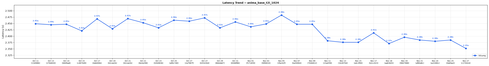

### Latency Trend: flux3_base_t2i_1024

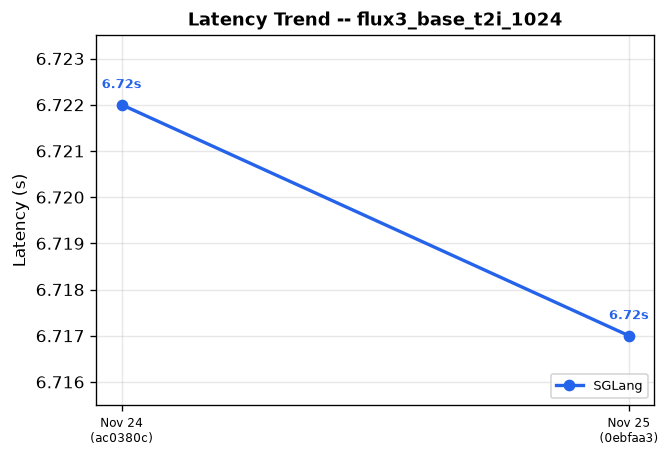

### Latency Trend: flux3_distilled_t2i_1024

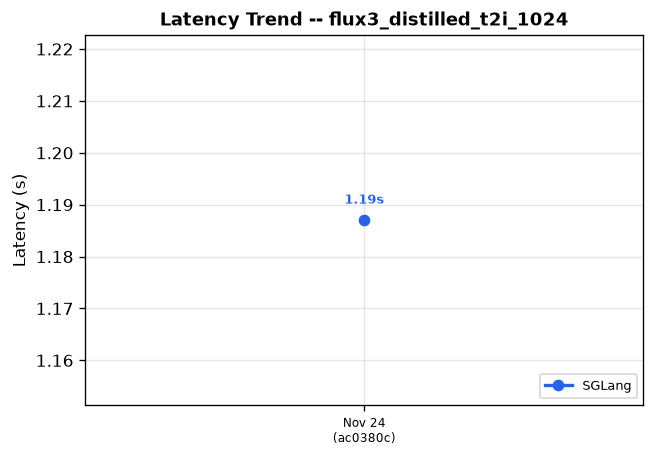

### Latency Trend: qwen_image_2512_t2i_1024

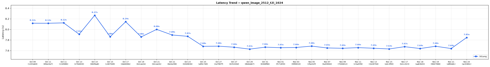

### Latency Trend: qwen_image_edit_2511

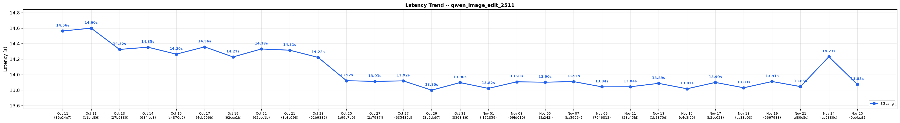

### Latency Trend: zimage_turbo_t2i_1024

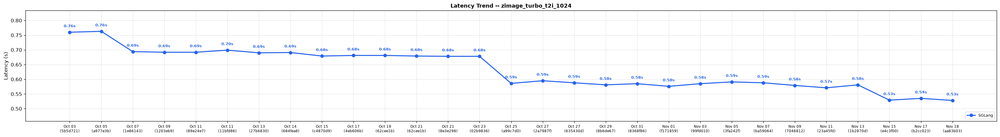

### Latency Trend: wan22_t2v_a14b_720p

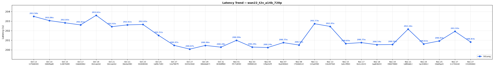

### Latency Trend: wan22_ti2v_5b_720p

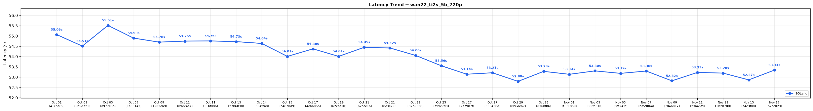

### Latency Trend: ltx2.3_twostage_ti2v_2gpus

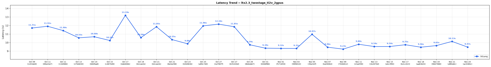

### Latency Trend: ideogram4_fp8_t2i_2gpu

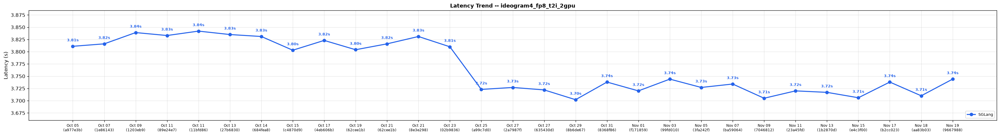

### Latency Trend: cosmos3_super_t2v_2gpu

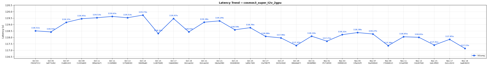

### Latency Trend: wan22_i2v_a14b_720p

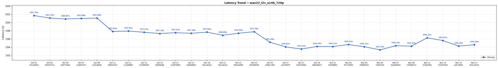

### Latency Trend: minimax_h3_t2va_5s

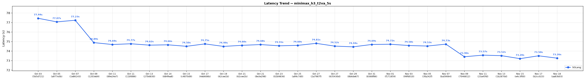

## SGLang Performance Trend (Last 29 Runs)

| Date | Commit | anima_base_t2i_1024 (s) | flux3_base_t2i_1024 (s) | flux3_distilled_t2i_1024 (s) | qwen_image_2512_t2i_1024 (s) | qwen_image_edit_2511 (s) | zimage_turbo_t2i_1024 (s) | wan22_t2v_a14b_720p (s) | wan22_ti2v_5b_720p (s) | ltx2.3_twostage_ti2v_2gpus (s) | ideogram4_fp8_t2i_2gpu (s) | cosmos3_super_t2v_2gpu (s) | wan22_i2v_a14b_720p (s) | minimax_h3_t2va_5s (s) | Trend |
|------|--------|---------|---------|---------|---------|---------|---------|---------|---------|---------|---------|---------|---------|---------|-------|
| Nov 27 | `c17042d` | 2.35 | 6.70 | 1.19 | 7.85 | 14.23 | 0.63 | 201.93 | 53.32 | 10.57 | 3.71 | 117.65 | 260.38 | 71.78 | :left_right_arrow:  :left_right_arrow:  :left_right_arrow:  :arrow_up:  :arrow_up:  :arrow_up:  :left_right_arrow:  :left_right_arrow:  :arrow_up:  :left_right_arrow:  :left_right_arrow:  :arrow_up:  :arrow_down: |
| Nov 25 | `0ebfaa3` | 2.38 | 6.72 | 1.19 | 7.63 | 13.88 | 0.52 | 200.93 | 52.79 | 9.08 | 3.71 | 117.13 | 194.46 | 73.27 | :left_right_arrow:  :left_right_arrow:  :left_right_arrow:  :arrow_down:  :arrow_down:  :arrow_down:  :left_right_arrow:  :left_right_arrow:  :arrow_down:  :left_right_arrow:  :left_right_arrow:  :left_right_arrow:  :left_right_arrow: |
| Nov 24 | `ac0380c` | 2.38 | 6.72 | 1.19 | 7.85 | 14.23 | 0.63 | 200.61 | 53.18 | 9.47 | 3.71 | 117.20 | 194.47 | 73.23 | :left_right_arrow:    :arrow_up:  :arrow_up:  :arrow_up:  :left_right_arrow:  :left_right_arrow:  :arrow_down:  :left_right_arrow:  :left_right_arrow:  :left_right_arrow:  :left_right_arrow: |
| Nov 21 | `af80e8c` | 2.38 | N/A | N/A | 7.64 | 13.85 | 0.53 | 202.16 | 53.16 | 10.13 | 3.72 | 117.89 | 195.67 | 73.44 | :left_right_arrow:    :left_right_arrow:  :left_right_arrow:  :left_right_arrow:  :left_right_arrow:  :left_right_arrow:  :arrow_up:  :left_right_arrow:  :left_right_arrow:  :left_right_arrow:  :left_right_arrow: |
| Nov 19 | `9667988` | 2.40 | N/A | N/A | 7.68 | 13.91 | 0.53 | 200.56 | 53.34 | 9.65 | 3.74 | 117.92 | 194.48 | 73.46 | :left_right_arrow:    :left_right_arrow:  :left_right_arrow:  :left_right_arrow:  :left_right_arrow:  :left_right_arrow:  :left_right_arrow:  :left_right_arrow:  :left_right_arrow:  :left_right_arrow:  :left_right_arrow: |
| Nov 18 | `aa83b03` | 2.37 | N/A | N/A | 7.64 | 13.83 | 0.53 | 200.54 | 52.87 | 9.46 | 3.71 | 117.15 | 194.20 | 73.26 | :left_right_arrow:    :left_right_arrow:  :left_right_arrow:  :left_right_arrow:  :left_right_arrow:  :left_right_arrow:  :arrow_down:  :left_right_arrow:  :left_right_arrow:  :left_right_arrow:  :left_right_arrow: |
| Nov 17 | `b2cc023` | 2.41 | N/A | N/A | 7.67 | 13.90 | 0.54 | 200.75 | 53.34 | 9.75 | 3.74 | 117.85 | 194.58 | 73.50 | :left_right_arrow:    :left_right_arrow:  :left_right_arrow:  :left_right_arrow:  :left_right_arrow:  :left_right_arrow:  :arrow_up:  :left_right_arrow:  :left_right_arrow:  :left_right_arrow:  :left_right_arrow: |
| Nov 15 | `e4c3f00` | 2.38 | N/A | N/A | 7.63 | 13.82 | 0.53 | 200.65 | 52.87 | 9.54 | 3.71 | 117.41 | 194.26 | 73.20 | :left_right_arrow:    :left_right_arrow:  :left_right_arrow:  :arrow_down:  :left_right_arrow:  :left_right_arrow:  :left_right_arrow:  :left_right_arrow:  :left_right_arrow:  :left_right_arrow:  :left_right_arrow: |
| Nov 13 | `1b2870d` | 2.38 | N/A | N/A | 7.64 | 13.89 | 0.58 | 202.45 | 53.20 | 9.54 | 3.72 | 118.01 | 195.61 | 73.52 | :left_right_arrow:    :left_right_arrow:  :left_right_arrow:  :left_right_arrow:  :left_right_arrow:  :left_right_arrow:  :arrow_down:  :left_right_arrow:  :left_right_arrow:  :left_right_arrow:  :left_right_arrow: |
| Nov 11 | `23a45fd` | 2.38 | N/A | N/A | 7.66 | 13.84 | 0.57 | 202.73 | 53.23 | 9.80 | 3.72 | 118.05 | 196.27 | 73.57 | :arrow_down:    :left_right_arrow:  :left_right_arrow:  :left_right_arrow:  :left_right_arrow:  :left_right_arrow:  :arrow_up:  :left_right_arrow:  :left_right_arrow:  :left_right_arrow:  :left_right_arrow: |
| Nov 09 | `7046812` | 2.45 | N/A | N/A | 7.64 | 13.84 | 0.58 | 200.50 | 52.82 | 9.23 | 3.71 | 117.36 | 194.24 | 73.40 | :left_right_arrow:    :left_right_arrow:  :left_right_arrow:  :left_right_arrow:  :left_right_arrow:  :left_right_arrow:  :arrow_down:  :left_right_arrow:  :left_right_arrow:  :left_right_arrow:  :left_right_arrow: |
| Nov 07 | `ba59064` | 2.45 | N/A | N/A | 7.65 | 13.91 | 0.59 | 200.75 | 53.30 | 9.46 | 3.73 | 118.27 | 194.35 | 74.73 | :left_right_arrow:    :left_right_arrow:  :left_right_arrow:  :left_right_arrow:  :left_right_arrow:  :left_right_arrow:  :arrow_down:  :left_right_arrow:  :left_right_arrow:  :left_right_arrow:  :left_right_arrow: |
| Nov 05 | `3fa242f` | 2.48 | N/A | N/A | 7.68 | 13.90 | 0.59 | 200.24 | 53.19 | 10.97 | 3.73 | 118.38 | 193.34 | 74.53 | :left_right_arrow:    :left_right_arrow:  :left_right_arrow:  :left_right_arrow:  :left_right_arrow:  :left_right_arrow:  :arrow_up:  :left_right_arrow:  :left_right_arrow:  :left_right_arrow:  :left_right_arrow: |
| Nov 03 | `99fd010` | 2.45 | N/A | N/A | 7.66 | 13.91 | 0.58 | 200.29 | 53.30 | 9.31 | 3.74 | 118.22 | 194.11 | 74.58 | :left_right_arrow:    :left_right_arrow:  :left_right_arrow:  :left_right_arrow:  :left_right_arrow:  :left_right_arrow:  :left_right_arrow:  :left_right_arrow:  :left_right_arrow:  :left_right_arrow:  :left_right_arrow: |
| Nov 01 | `f171859` | 2.44 | N/A | N/A | 7.65 | 13.82 | 0.58 | 200.99 | 53.14 | 9.32 | 3.72 | 117.71 | 194.63 | 74.72 | :left_right_arrow:    :left_right_arrow:  :left_right_arrow:  :left_right_arrow:  :left_right_arrow:  :left_right_arrow:  :left_right_arrow:  :left_right_arrow:  :left_right_arrow:  :left_right_arrow:  :left_right_arrow: |
| Oct 31 | `8368f86` | 2.46 | N/A | N/A | 7.66 | 13.90 | 0.58 | 200.28 | 53.28 | 9.34 | 3.74 | 118.10 | 194.15 | 74.69 | :left_right_arrow:    :left_right_arrow:  :left_right_arrow:  :left_right_arrow:  :left_right_arrow:  :left_right_arrow:  :arrow_down:  :left_right_arrow:  :left_right_arrow:  :left_right_arrow:  :left_right_arrow: |
| Oct 29 | `8b6de67` | 2.43 | N/A | N/A | 7.63 | 13.80 | 0.58 | 200.46 | 52.80 | 9.74 | 3.70 | 117.37 | 194.16 | 74.44 | :left_right_arrow:    :left_right_arrow:  :left_right_arrow:  :left_right_arrow:  :left_right_arrow:  :left_right_arrow:  :arrow_down:  :left_right_arrow:  :left_right_arrow:  :left_right_arrow:  :left_right_arrow: |
| Oct 27 | `635430d` | 2.47 | N/A | N/A | 7.66 | 13.92 | 0.59 | 200.07 | 53.21 | 11.85 | 3.72 | 117.96 | 193.54 | 74.52 | :left_right_arrow:    :left_right_arrow:  :left_right_arrow:  :left_right_arrow:  :left_right_arrow:  :left_right_arrow:  :arrow_down:  :left_right_arrow:  :left_right_arrow:  :left_right_arrow:  :left_right_arrow: |
| Oct 27 | `2a7987f` | 2.46 | N/A | N/A | 7.68 | 13.91 | 0.59 | 200.47 | 53.14 | 12.16 | 3.73 | 118.08 | 194.07 | 74.81 | :left_right_arrow:    :left_right_arrow:  :left_right_arrow:  :left_right_arrow:  :left_right_arrow:  :left_right_arrow:  :left_right_arrow:  :left_right_arrow:  :left_right_arrow:  :left_right_arrow:  :left_right_arrow: |
| Oct 25 | `a99c7d0` | 2.46 | N/A | N/A | 7.68 | 13.92 | 0.59 | 201.51 | 53.56 | 11.96 | 3.72 | 118.76 | 195.20 | 74.60 | :left_right_arrow:    :arrow_down:  :arrow_down:  :arrow_down:  :left_right_arrow:  :left_right_arrow:  :arrow_up:  :arrow_down:  :left_right_arrow:  :left_right_arrow:  :left_right_arrow: |
| Oct 23 | `02b9836` | 2.43 | N/A | N/A | 7.87 | 14.22 | 0.68 | 202.65 | 54.06 | 9.86 | 3.81 | 118.59 | 197.76 | 74.55 | :left_right_arrow:    :left_right_arrow:  :left_right_arrow:  :left_right_arrow:  :left_right_arrow:  :left_right_arrow:  :arrow_down:  :left_right_arrow:  :left_right_arrow:  :left_right_arrow:  :left_right_arrow: |
| Oct 21 | `8e3e298` | 2.45 | N/A | N/A | 7.89 | 14.31 | 0.68 | 202.61 | 54.42 | 10.35 | 3.83 | 119.29 | 197.40 | 74.68 | :left_right_arrow:    :left_right_arrow:  :left_right_arrow:  :left_right_arrow:  :left_right_arrow:  :left_right_arrow:  :arrow_down:  :left_right_arrow:  :left_right_arrow:  :left_right_arrow:  :left_right_arrow: |
| Oct 21 | `62cee1b` | 2.47 | N/A | N/A | 8.00 | 14.33 | 0.68 | 202.42 | 54.45 | 11.85 | 3.82 | 119.18 | 196.89 | 74.60 | :left_right_arrow:    :left_right_arrow:  :left_right_arrow:  :left_right_arrow:  :left_right_arrow:  :left_right_arrow:  :arrow_up:  :left_right_arrow:  :left_right_arrow:  :left_right_arrow:  :left_right_arrow: |
| Oct 19 | `62cee1b` | 2.43 | N/A | N/A | 7.86 | 14.23 | 0.68 | 203.61 | 54.01 | 10.59 | 3.80 | 118.43 | 197.66 | 74.49 | :left_right_arrow:    :arrow_down:  :left_right_arrow:  :left_right_arrow:  :left_right_arrow:  :left_right_arrow:  :arrow_down:  :left_right_arrow:  :left_right_arrow:  :left_right_arrow:  :left_right_arrow: |
| Oct 17 | `4eb606b` | 2.47 | N/A | N/A | 8.14 | 14.36 | 0.68 | 202.61 | 54.38 | 13.19 | 3.82 | 119.47 | 197.38 | 74.75 | :left_right_arrow:    :arrow_up:  :left_right_arrow:  :left_right_arrow:  :left_right_arrow:  :left_right_arrow:  :arrow_up:  :left_right_arrow:  :left_right_arrow:  :left_right_arrow:  :left_right_arrow: |
| Oct 15 | `c4870d9` | 2.42 | N/A | N/A | 7.86 | 14.26 | 0.68 | 202.83 | 54.01 | 10.24 | 3.80 | 118.31 | 197.52 | 74.50 | :left_right_arrow:    :arrow_down:  :left_right_arrow:  :left_right_arrow:  :left_right_arrow:  :left_right_arrow:  :arrow_down:  :left_right_arrow:  :left_right_arrow:  :left_right_arrow:  :left_right_arrow: |
| Oct 14 | `684fea8` | 2.45 | N/A | N/A | 8.27 | 14.35 | 0.69 | 203.06 | 54.64 | 10.68 | 3.83 | 119.73 | 197.32 | 74.66 | :left_right_arrow:    :arrow_up:  :left_right_arrow:  :left_right_arrow:  :left_right_arrow:  :left_right_arrow:  :left_right_arrow:  :left_right_arrow:  :left_right_arrow:  :left_right_arrow:  :left_right_arrow: |
| Oct 13 | `27b6830` | 2.44 | N/A | N/A | 7.91 | 14.32 | 0.69 | 203.50 | 54.73 | 10.55 | 3.83 | 119.53 | 197.63 | 74.62 | :left_right_arrow:    :arrow_down:  :left_right_arrow:  :left_right_arrow:  :left_right_arrow:  :left_right_arrow:  :arrow_down:  :left_right_arrow:  :left_right_arrow:  :left_right_arrow:  :left_right_arrow: |
| Oct 11 | `11bfd86` | 2.45 | N/A | N/A | 8.12 | 14.60 | 0.70 | 203.29 | 54.76 | 11.40 | 3.84 | 119.63 | 197.92 | 74.77 | -- |

> [!CAUTION]
> **Action Required — Performance Alert**
>
> The following cases need attention:
> - zimage_turbo_t2i_1024: SGLang regression +20.1% vs 5-run median (0.63s vs 0.53s)
> - ltx2.3_twostage_ti2v_2gpus: SGLang regression +11.5% vs 5-run median (10.57s vs 9.47s)
> - wan22_i2v_a14b_720p: SGLang regression +33.9% vs 5-run median (260.38s vs 194.47s)

---
*Generated by `generate_diffusion_dashboard.py` in SGLang nightly CI.*
