# SGLang-Diffusion Nightly Performance Dashboard

*Generated: Nov 05 | Commit: `3fa242f`*

*Methodology `client-e2e-v1`: client-side latency through each framework's public API, from submit until the output is downloaded; 1 identical client warmup request(s) per case, discarded. First request = the first request after the server reports ready. Server perf dumps are telemetry only.*

*Excluded 7 historical run(s) from baselines and trends because their measurement methodology or warmup count differs. Missing metadata is not treated as matching explicit metadata.*

> [!WARNING]
> **Performance Regression Detected**
>
> - **ltx2.3_twostage_ti2v_2gpus** (sglang): 10.97s vs 5-run median 9.34s (+17.4%)

## SGLang-Diffusion Performance

| Model | Risk | Client samples | Server samples | First request (s) | sglang median (s) |
|-------|------|----------------|----------------|-------------------|---------|
| Anima-Base-v1.0-Diffusers | ✅ | 3 | 3/3 | 2.50 | **2.48** |
| FLUX.1-dev | ✅ | 3 | 3/3 | 4.09 | **4.12** |
| FLUX.2-dev | ✅ | 3 | 3/3 | 13.13 | **12.95** |
| Qwen-Image-2512 | ✅ | 3 | 3/3 | 7.71 | **7.68** |
| Qwen-Image-Edit-2511 | ✅ | 3 | 3/3 | 13.86 | **13.90** |
| Z-Image-Turbo | ✅ | 3 | 3/3 | 0.59 | **0.59** |
| Wan2.2-T2V-A14B-Diffusers | ✅ | 3 | 3/3 | 200.15 | **200.24** |
| Wan2.2-TI2V-5B-Diffusers | ✅ | 3 | 3/3 | 53.02 | **53.19** |
| LTX-2.3 | ⚠️ | 3 | 3/3 | 13.43 | **10.97** |
| ideogram-4-fp8 | ✅ | 3 | 3/3 | 3.74 | **3.73** |
| Cosmos3-Super | ✅ | 3 | 3/3 | 119.68 | **118.38** |
| Wan2.2-I2V-A14B-Diffusers | ✅ | 3 | 3/3 | 192.99 | **193.34** |
| MiniMax-H3 | ✅ | 3 | 3/3 | 74.23 | **74.53** |

## SGLang Server-Side Breakdown

| Model | Server total (s) | Text encode (s) | Denoise (s) | Decode (s) | Median denoise step (ms) |
|-------|------------------|-----------------|--------------|------------|---------------------------|
| Anima-Base-v1.0-Diffusers | 2.47 | 0.02 | 2.19 | 0.24 | 73.49 |
| FLUX.1-dev | 4.02 | 0.02 | 3.99 | 0.01 | 79.83 |
| FLUX.2-dev | 12.91 | 0.36 | 12.09 | 0.01 | 241.37 |
| Qwen-Image-2512 | 7.58 | 0.03 | 7.54 | 0.01 | 151.25 |
| Qwen-Image-Edit-2511 | 13.75 | N/A | 13.49 | 0.02 | 339.91 |
| Z-Image-Turbo | 0.50 | 0.04 | 0.45 | 0.01 | 55.52 |
| Wan2.2-T2V-A14B-Diffusers | 200.22 | 0.27 | 198.14 | 1.52 | 4952.88 |
| Wan2.2-TI2V-5B-Diffusers | 53.12 | 0.13 | 46.51 | 6.47 | 942.63 |
| LTX-2.3 | 10.90 | 0.40 | 8.57 | 0.62 | 285.23 |
| ideogram-4-fp8 | 3.57 | 0.13 | 3.41 | 0.03 | 172.38 |
| Cosmos3-Super | 118.35 | 0.00 | 116.02 | 1.75 | N/A |
| Wan2.2-I2V-A14B-Diffusers | 193.29 | 0.27 | 188.94 | 1.47 | 4717.65 |
| MiniMax-H3 | 74.48 | 0.06 | 72.08 | 1.33 | 1460.42 |

### Latency Trend: anima_base_t2i_1024

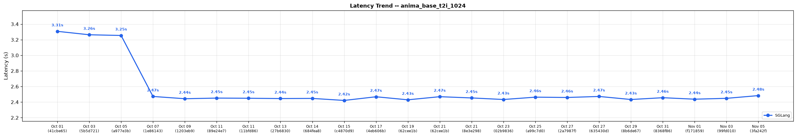

### Latency Trend: flux1_dev_t2i_1024

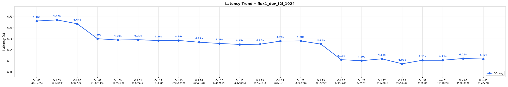

### Latency Trend: flux2_dev_t2i_1024

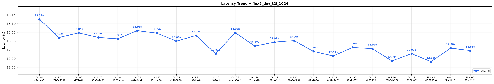

### Latency Trend: qwen_image_2512_t2i_1024

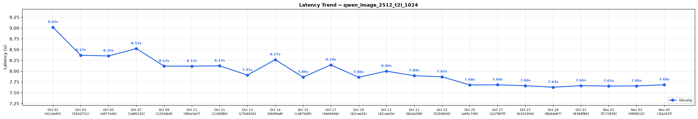

### Latency Trend: qwen_image_edit_2511

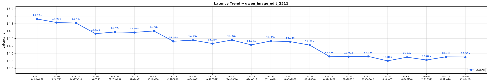

### Latency Trend: zimage_turbo_t2i_1024

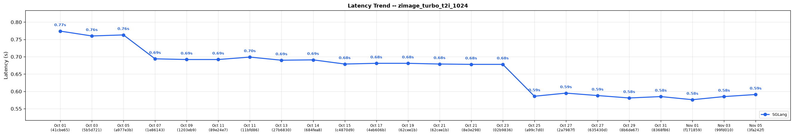

### Latency Trend: wan22_t2v_a14b_720p

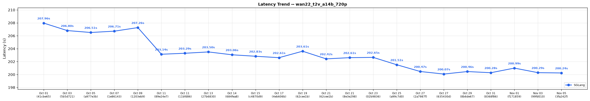

### Latency Trend: wan22_ti2v_5b_720p

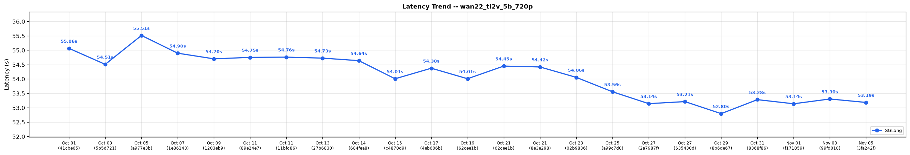

### Latency Trend: ltx2.3_twostage_ti2v_2gpus

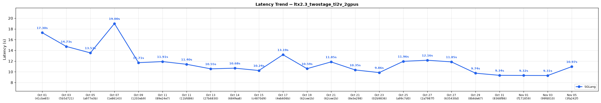

### Latency Trend: ideogram4_fp8_t2i_2gpu

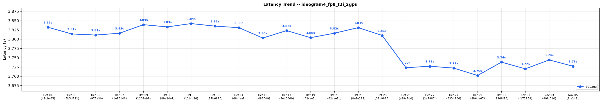

### Latency Trend: cosmos3_super_t2v_2gpu

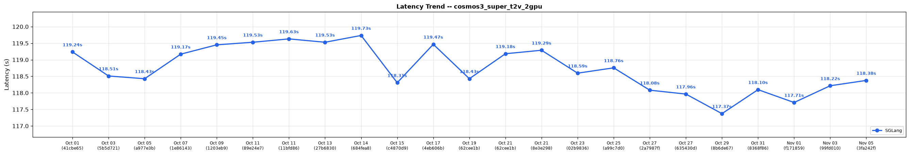

### Latency Trend: wan22_i2v_a14b_720p

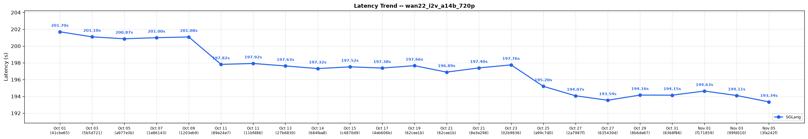

### Latency Trend: minimax_h3_t2va_5s

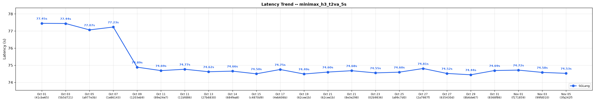

## SGLang Performance Trend (Last 23 Runs)

| Date | Commit | anima_base_t2i_1024 (s) | flux1_dev_t2i_1024 (s) | flux2_dev_t2i_1024 (s) | qwen_image_2512_t2i_1024 (s) | qwen_image_edit_2511 (s) | zimage_turbo_t2i_1024 (s) | wan22_t2v_a14b_720p (s) | wan22_ti2v_5b_720p (s) | ltx2.3_twostage_ti2v_2gpus (s) | ideogram4_fp8_t2i_2gpu (s) | cosmos3_super_t2v_2gpu (s) | wan22_i2v_a14b_720p (s) | minimax_h3_t2va_5s (s) | Trend |
|------|--------|---------|---------|---------|---------|---------|---------|---------|---------|---------|---------|---------|---------|---------|-------|
| Nov 05 | `3fa242f` | 2.48 | 4.12 | 12.95 | 7.68 | 13.90 | 0.59 | 200.24 | 53.19 | 10.97 | 3.73 | 118.38 | 193.34 | 74.53 | :left_right_arrow:  :left_right_arrow:  :left_right_arrow:  :left_right_arrow:  :left_right_arrow:  :left_right_arrow:  :left_right_arrow:  :left_right_arrow:  :arrow_up:  :left_right_arrow:  :left_right_arrow:  :left_right_arrow:  :left_right_arrow: |
| Nov 03 | `99fd010` | 2.45 | 4.12 | 12.96 | 7.66 | 13.91 | 0.58 | 200.29 | 53.30 | 9.31 | 3.74 | 118.22 | 194.11 | 74.58 | :left_right_arrow:  :left_right_arrow:  :left_right_arrow:  :left_right_arrow:  :left_right_arrow:  :left_right_arrow:  :left_right_arrow:  :left_right_arrow:  :left_right_arrow:  :left_right_arrow:  :left_right_arrow:  :left_right_arrow:  :left_right_arrow: |
| Nov 01 | `f171859` | 2.44 | 4.11 | 12.88 | 7.65 | 13.82 | 0.58 | 200.99 | 53.14 | 9.32 | 3.72 | 117.71 | 194.63 | 74.72 | :left_right_arrow:  :left_right_arrow:  :left_right_arrow:  :left_right_arrow:  :left_right_arrow:  :left_right_arrow:  :left_right_arrow:  :left_right_arrow:  :left_right_arrow:  :left_right_arrow:  :left_right_arrow:  :left_right_arrow:  :left_right_arrow: |
| Oct 31 | `8368f86` | 2.46 | 4.11 | 12.93 | 7.66 | 13.90 | 0.58 | 200.28 | 53.28 | 9.34 | 3.74 | 118.10 | 194.15 | 74.69 | :left_right_arrow:  :left_right_arrow:  :left_right_arrow:  :left_right_arrow:  :left_right_arrow:  :left_right_arrow:  :left_right_arrow:  :left_right_arrow:  :arrow_down:  :left_right_arrow:  :left_right_arrow:  :left_right_arrow:  :left_right_arrow: |
| Oct 29 | `8b6de67` | 2.43 | 4.07 | 12.89 | 7.63 | 13.80 | 0.58 | 200.46 | 52.80 | 9.74 | 3.70 | 117.37 | 194.16 | 74.44 | :left_right_arrow:  :left_right_arrow:  :left_right_arrow:  :left_right_arrow:  :left_right_arrow:  :left_right_arrow:  :left_right_arrow:  :left_right_arrow:  :arrow_down:  :left_right_arrow:  :left_right_arrow:  :left_right_arrow:  :left_right_arrow: |
| Oct 27 | `635430d` | 2.47 | 4.12 | 12.96 | 7.66 | 13.92 | 0.59 | 200.07 | 53.21 | 11.85 | 3.72 | 117.96 | 193.54 | 74.52 | :left_right_arrow:  :left_right_arrow:  :left_right_arrow:  :left_right_arrow:  :left_right_arrow:  :left_right_arrow:  :left_right_arrow:  :left_right_arrow:  :arrow_down:  :left_right_arrow:  :left_right_arrow:  :left_right_arrow:  :left_right_arrow: |
| Oct 27 | `2a7987f` | 2.46 | 4.10 | 12.96 | 7.68 | 13.91 | 0.59 | 200.47 | 53.14 | 12.16 | 3.73 | 118.08 | 194.07 | 74.81 | :left_right_arrow:  :left_right_arrow:  :left_right_arrow:  :left_right_arrow:  :left_right_arrow:  :left_right_arrow:  :left_right_arrow:  :left_right_arrow:  :left_right_arrow:  :left_right_arrow:  :left_right_arrow:  :left_right_arrow:  :left_right_arrow: |
| Oct 25 | `a99c7d0` | 2.46 | 4.11 | 12.91 | 7.68 | 13.92 | 0.59 | 201.51 | 53.56 | 11.96 | 3.72 | 118.76 | 195.20 | 74.60 | :left_right_arrow:  :arrow_down:  :left_right_arrow:  :arrow_down:  :arrow_down:  :arrow_down:  :left_right_arrow:  :left_right_arrow:  :arrow_up:  :arrow_down:  :left_right_arrow:  :left_right_arrow:  :left_right_arrow: |
| Oct 23 | `02b9836` | 2.43 | 4.25 | 12.94 | 7.87 | 14.22 | 0.68 | 202.65 | 54.06 | 9.86 | 3.81 | 118.59 | 197.76 | 74.55 | :left_right_arrow:  :left_right_arrow:  :left_right_arrow:  :left_right_arrow:  :left_right_arrow:  :left_right_arrow:  :left_right_arrow:  :left_right_arrow:  :arrow_down:  :left_right_arrow:  :left_right_arrow:  :left_right_arrow:  :left_right_arrow: |
| Oct 21 | `8e3e298` | 2.45 | 4.28 | 13.00 | 7.89 | 14.31 | 0.68 | 202.61 | 54.42 | 10.35 | 3.83 | 119.29 | 197.40 | 74.68 | :left_right_arrow:  :left_right_arrow:  :left_right_arrow:  :left_right_arrow:  :left_right_arrow:  :left_right_arrow:  :left_right_arrow:  :left_right_arrow:  :arrow_down:  :left_right_arrow:  :left_right_arrow:  :left_right_arrow:  :left_right_arrow: |
| Oct 21 | `62cee1b` | 2.47 | 4.28 | 12.99 | 8.00 | 14.33 | 0.68 | 202.42 | 54.45 | 11.85 | 3.82 | 119.18 | 196.89 | 74.60 | :left_right_arrow:  :left_right_arrow:  :left_right_arrow:  :left_right_arrow:  :left_right_arrow:  :left_right_arrow:  :left_right_arrow:  :left_right_arrow:  :arrow_up:  :left_right_arrow:  :left_right_arrow:  :left_right_arrow:  :left_right_arrow: |
| Oct 19 | `62cee1b` | 2.43 | 4.25 | 12.97 | 7.86 | 14.23 | 0.68 | 203.61 | 54.01 | 10.59 | 3.80 | 118.43 | 197.66 | 74.49 | :left_right_arrow:  :left_right_arrow:  :left_right_arrow:  :arrow_down:  :left_right_arrow:  :left_right_arrow:  :left_right_arrow:  :left_right_arrow:  :arrow_down:  :left_right_arrow:  :left_right_arrow:  :left_right_arrow:  :left_right_arrow: |
| Oct 17 | `4eb606b` | 2.47 | 4.25 | 13.05 | 8.14 | 14.36 | 0.68 | 202.61 | 54.38 | 13.19 | 3.82 | 119.47 | 197.38 | 74.75 | :left_right_arrow:  :left_right_arrow:  :left_right_arrow:  :arrow_up:  :left_right_arrow:  :left_right_arrow:  :left_right_arrow:  :left_right_arrow:  :arrow_up:  :left_right_arrow:  :left_right_arrow:  :left_right_arrow:  :left_right_arrow: |
| Oct 15 | `c4870d9` | 2.42 | 4.26 | 12.93 | 7.86 | 14.26 | 0.68 | 202.83 | 54.01 | 10.24 | 3.80 | 118.31 | 197.52 | 74.50 | :left_right_arrow:  :left_right_arrow:  :left_right_arrow:  :arrow_down:  :left_right_arrow:  :left_right_arrow:  :left_right_arrow:  :left_right_arrow:  :arrow_down:  :left_right_arrow:  :left_right_arrow:  :left_right_arrow:  :left_right_arrow: |
| Oct 14 | `684fea8` | 2.45 | 4.27 | 13.03 | 8.27 | 14.35 | 0.69 | 203.06 | 54.64 | 10.68 | 3.83 | 119.73 | 197.32 | 74.66 | :left_right_arrow:  :left_right_arrow:  :left_right_arrow:  :arrow_up:  :left_right_arrow:  :left_right_arrow:  :left_right_arrow:  :left_right_arrow:  :left_right_arrow:  :left_right_arrow:  :left_right_arrow:  :left_right_arrow:  :left_right_arrow: |
| Oct 13 | `27b6830` | 2.44 | 4.29 | 13.00 | 7.91 | 14.32 | 0.69 | 203.50 | 54.73 | 10.55 | 3.83 | 119.53 | 197.63 | 74.62 | :left_right_arrow:  :left_right_arrow:  :left_right_arrow:  :arrow_down:  :left_right_arrow:  :left_right_arrow:  :left_right_arrow:  :left_right_arrow:  :arrow_down:  :left_right_arrow:  :left_right_arrow:  :left_right_arrow:  :left_right_arrow: |
| Oct 11 | `11bfd86` | 2.45 | 4.28 | 13.04 | 8.12 | 14.60 | 0.70 | 203.29 | 54.76 | 11.40 | 3.84 | 119.63 | 197.92 | 74.77 | :left_right_arrow:  :left_right_arrow:  :left_right_arrow:  :left_right_arrow:  :left_right_arrow:  :left_right_arrow:  :left_right_arrow:  :left_right_arrow:  :arrow_down:  :left_right_arrow:  :left_right_arrow:  :left_right_arrow:  :left_right_arrow: |
| Oct 11 | `89e24e7` | 2.45 | 4.29 | 13.06 | 8.12 | 14.56 | 0.69 | 203.14 | 54.75 | 11.91 | 3.83 | 119.53 | 197.82 | 74.69 | :left_right_arrow:  :left_right_arrow:  :left_right_arrow:  :left_right_arrow:  :left_right_arrow:  :left_right_arrow:  :left_right_arrow:  :left_right_arrow:  :left_right_arrow:  :left_right_arrow:  :left_right_arrow:  :left_right_arrow:  :left_right_arrow: |
| Oct 09 | `1203eb9` | 2.44 | 4.29 | 13.01 | 8.12 | 14.57 | 0.69 | 207.26 | 54.70 | 11.71 | 3.84 | 119.45 | 201.08 | 74.89 | :left_right_arrow:  :left_right_arrow:  :left_right_arrow:  :arrow_down:  :left_right_arrow:  :left_right_arrow:  :left_right_arrow:  :left_right_arrow:  :arrow_down:  :left_right_arrow:  :left_right_arrow:  :left_right_arrow:  :arrow_down: |
| Oct 07 | `1e86143` | 2.47 | 4.30 | 13.02 | 8.52 | 14.53 | 0.69 | 206.71 | 54.90 | 19.00 | 3.82 | 119.17 | 201.00 | 77.23 | :arrow_down:  :arrow_down:  :left_right_arrow:  :arrow_up:  :left_right_arrow:  :arrow_down:  :left_right_arrow:  :left_right_arrow:  :arrow_up:  :left_right_arrow:  :left_right_arrow:  :left_right_arrow:  :left_right_arrow: |
| Oct 05 | `a977e3b` | 3.25 | 4.44 | 13.05 | 8.35 | 14.81 | 0.76 | 206.51 | 55.51 | 13.53 | 3.81 | 118.43 | 200.87 | 77.07 | :left_right_arrow:  :left_right_arrow:  :left_right_arrow:  :left_right_arrow:  :left_right_arrow:  :left_right_arrow:  :left_right_arrow:  :left_right_arrow:  :arrow_down:  :left_right_arrow:  :left_right_arrow:  :left_right_arrow:  :left_right_arrow: |
| Oct 03 | `5b5d721` | 3.26 | 4.47 | 13.02 | 8.37 | 14.83 | 0.76 | 206.80 | 54.51 | 14.73 | 3.81 | 118.51 | 201.10 | 77.44 | :left_right_arrow:  :left_right_arrow:  :left_right_arrow:  :arrow_down:  :left_right_arrow:  :left_right_arrow:  :left_right_arrow:  :left_right_arrow:  :arrow_down:  :left_right_arrow:  :left_right_arrow:  :left_right_arrow:  :left_right_arrow: |
| Oct 01 | `41cbe65` | 3.31 | 4.46 | 13.12 | 9.02 | 14.92 | 0.77 | 207.96 | 55.06 | 17.30 | 3.83 | 119.24 | 201.70 | 77.45 | -- |

> [!CAUTION]
> **Action Required — Performance Alert**
>
> The following cases need attention:
> - ltx2.3_twostage_ti2v_2gpus: SGLang regression +17.4% vs 5-run median (10.97s vs 9.34s)

---
*Generated by `generate_diffusion_dashboard.py` in SGLang nightly CI.*
